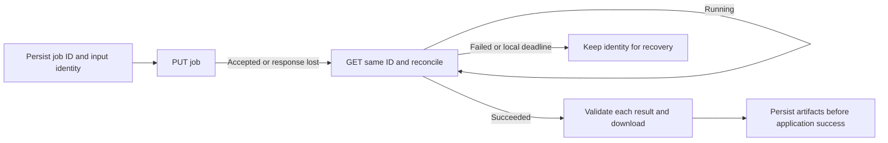

# Durable Batch synthesis

For asynchronous bulk/long-form generation. Check current Standard-tier, region/voice and payload support. Short files can use real-time; do not choose legacy Long Audio.

## Submit once, recover the same job



Bound polling/backoff by the application's deadline. Local timeout does not cancel remote synthesis. Never generate a new ID after an ambiguous submission or resynthesize because a download failed.

## Wire contract

```http
PUT /texttospeech/batchsyntheses/<id>?api-version=2024-04-01 HTTP/1.1
Host: <resource>.cognitiveservices.azure.com
Content-Type: application/json
Ocp-Apim-Subscription-Key: <backend-runtime-value>
```

```json
{
  "inputKind": "PlainText",
  "synthesisConfig": {"voice": "en-US-JennyNeural"},
  "inputs": [{"content": "Hello"}],
  "properties": {"outputFormat": "riff-24khz-16bit-mono-pcm"}
}
```

Voice/key are examples; preserve approved identity. IDs: 3–64 characters, alphanumeric ends, internal hyphens/underscores/dots allowed. For SSML use `inputKind: SSML` and voices in markup. Enable concatenation only if wanted. Check current limits using serialized UTF-8 bytes, not character count.

## Complete the application job

| Boundary | Required check |
|---|---|
| Recovery | ID/input mapping persisted **before PUT**; restart reconciles the same job |
| Download | `outputs.result`; do not forward Speech credentials to storage/redirect hosts; redact SAS |
| Archive | Bound download/expanded size; prevent path traversal |
| Per-input result | `summary.json` → `results[].status` and `audioFileName`; validate order/count/audio |
| Durable completion | Persist artifacts/metadata; temporary result URLs are not storage |

Top-level Succeeded can contain per-input failures. Reuse storage/worker design; no automatic cloud/network changes or history deletion. Retention follows agreed policy after durable storage. Verify ambiguous PUT, restart, partial failures and audio decoding; mocks do not establish service access.

Sources: [Batch](https://learn.microsoft.com/azure/ai-services/speech-service/batch-synthesis), [properties](https://learn.microsoft.com/azure/ai-services/speech-service/batch-synthesis-properties). Docs checked 2026-10-19.
