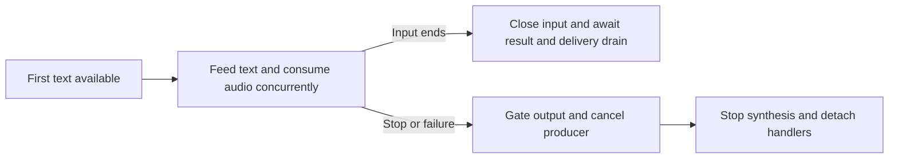

# Text-input streaming beyond the adapter

Use for incremental plain text that must be synthesized before all input arrives. For the bundled Python module, use its [public contract](languages/python.md#adapter-contract); this file explains service behavior and direct SDK implementation. Complete text with progressive audio is [output streaming](realtime-sdk.md), not TextStream.

## Direct SDK sequence

| Step | Python SDK |
|---|---|
| Configure | SpeechConfig(subscription=..., endpoint=v2_url), or the supported token_credential overload; set voice/output |
| LLM pause protection | Set SpeechSynthesis_FrameTimeoutInterval to 100000000 and SpeechSynthesis_RtfTimeoutThreshold to 10 as the official sample does |
| Wait for usable input | Receive the first nonempty token locally before starting the request; preserve whitespace in text fragments |
| Subscribe / start | SpeechSynthesizer(..., audio_config=None); synthesizing.connect(handler); SpeechSynthesisRequest(input_type=SpeechSynthesisRequestInputType.TextStream); speak_async(request) |
| Feed / finish | request.input_stream.write(delta), then input_stream.close() when input ends |
| Observe / stop | future.get() and stop_speaking_async().get() off-loop |
| Detach | synthesizing.disconnect_all(); Python has no per-handler disconnect(handler) or universal synthesizer close() |

V2 regional route: wss://<region>.tts.speech.microsoft.com/cognitiveservices/websocket/v2. Resource-base route: wss://<host>/tts/cognitiveservices/websocket/v2. A plain HTTPS synthesis endpoint is not a TextStream endpoint. Preserve the configured host and verify custom/private routing and identity combinations rather than guessing from a region.

Current official TextStream guidance lists C#, C++ and Python; no SSML input or OpenAI TTS voices. C# sample uses StartSpeakingAsync(request) and AudioDataStream. Do not infer a JavaScript or Java TextStream API from Python names. See [capabilities](capabilities.md) for implementation and verification coverage.

## Diagnose service timing

| Observation | Distinguishing check |
|---|---|
| No audio from a few fragments | Buffering/voice may defer speech until enough text or input close; token arrival does not guarantee one audio chunk |
| ServiceTimeout after an LLM pause | Inspect SDK cancellation code and the two timeout settings; do not silently replay delivered speech |
| No first token for a long time | Keep waiting locally, allow cancellation; official issue 2008 describes no-input request failure around 30 seconds |
| Long gap despite valid output | Measure first text, first audio and input-end separately; do not call eventual audio low latency |

Local live observations are examples, not universal thresholds: SDK defaults canceled one 12-second mid-reply pause; the sample properties completed it. A later frozen-adapter check waited 35 seconds for text plus 12 seconds mid-reply and completed, but first audio arrived only at about 47.8 seconds. No listening or transcription was performed in that check.

## Own the direct-SDK lifecycle

Race a stalled producer against stop, failed synthesis and consumer failure. End-of-input is not cancellation. Reserve output capacity before scheduling native callbacks; bounding only a downstream queue leaves loop scheduling unbounded. On overload fail and stop, never drop audio and return success. Isolate cancellation/output ownership per turn. Release a synthesizer for reuse only after completed result, delivery drain and successful cleanup.

When changing native behavior, verify early output, exact fragments, normal drain, waiting-input stop, disconnected/slow consumer, burst admission, late-audio suppression and concurrent isolation. Use the installed language SDK signatures and official examples; mocked service events do not prove production timing.

Sources: [latency/TextStream](https://learn.microsoft.com/azure/ai-services/speech-service/how-to-lower-speech-synthesis-latency), [known issue 2008](https://learn.microsoft.com/azure/ai-services/speech-service/known-issues), [Python sample](https://github.com/Azure-Samples/cognitive-services-speech-sdk/tree/master/samples/python/tts-text-stream), [C# sample](https://github.com/Azure-Samples/cognitive-services-speech-sdk/tree/master/samples/csharp/tts-text-stream).
